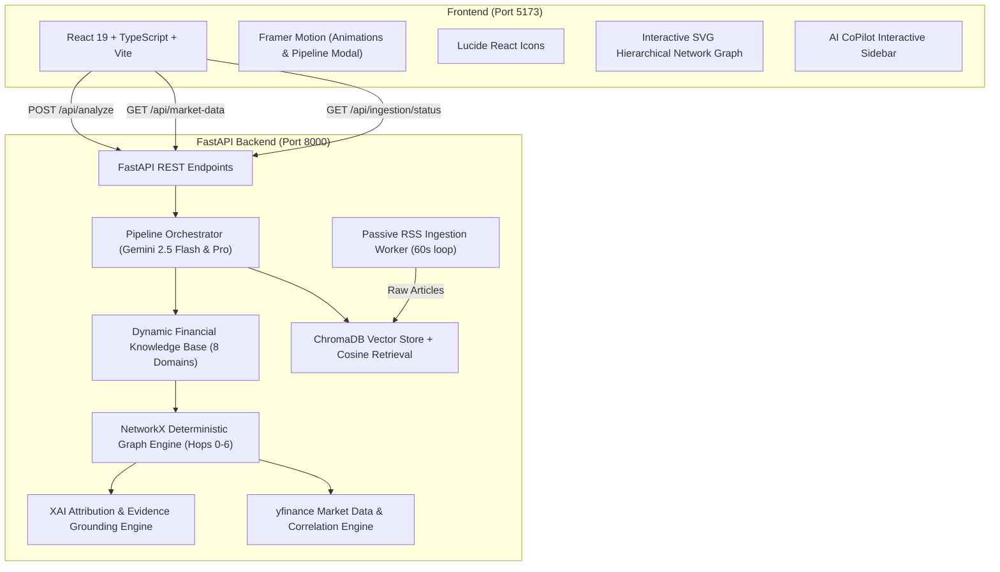
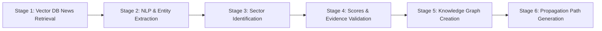

# FinGraph (SCYP_X) — Architecture, Page Guide & Technical Documentation

---

## 1. Executive Summary & Project Purpose

**FinGraph** is an enterprise-grade **Financial Knowledge Graph & Cross-Asset Propagation Intelligence Platform**.

Traditional financial news analysis provides surface-level information (e.g., *"Crude oil prices rise 12%"*), leaving economists, risk managers, and traders to manually deduce downstream cascading impacts across multi-tier supply chains, macro inflation indicators, interest rates, equities, and industry sectors.

FinGraph automates causal macroeconomic and supply-chain reasoning:
1. Ingests streaming financial news articles via RSS and vectorizes them into ChromaDB.
2. Accepts natural language event shocks or user queries.
3. Orchestrates a **6-stage pipeline** with Gemini AI & NLP models.
4. Generates an interactive **multi-hop directed acyclic graph (DAG)** spanning Hops 0 through 6.
5. Quantifies transmission scores, validates relationships against evidence snippets, enriches equities with real-time **Yahoo Finance time-series data**, and presents explainable attribution (XAI).

---

## 2. Platform Architecture & Technology Stack



### Technology Breakdown

| Layer | Technologies Used | Key Purpose |
|---|---|---|
| **Frontend Framework** | **React 19**, **TypeScript**, **Vite 8** | High-performance, type-safe reactive single-page application. |
| **Styling & Motion** | **Tailwind CSS v4**, **Framer Motion**, Custom CSS Design System | Clean, high-density financial terminal layout with interactive modal animations. |
| **Iconography** | **Lucide React** | Consistent financial, status, and navigation icons. |
| **Visualization** | Custom **SVG Hierarchical Network Graph** | Multi-tier radial/hierarchical canvas layout with panning, zooming, node expansion, and color coding. |
| **Backend Framework** | **Python 3.10+**, **FastAPI**, **Uvicorn** | Asynchronous, low-latency REST API service with schema validation. |
| **LLM & Reasoning** | **Google GenAI SDK** (`gemini-2.5-flash`, `gemini-2.5-pro`), Fallback NLP Knowledge Engine | Two-stage extraction and causal economic propagation graph generation. |
| **Vector Database** | **ChromaDB**, **Sentence Transformers / Embeddings** | Semantic document chunking, vector similarity retrieval, and query logging. |
| **Graph Modeling** | **NetworkX 3.2** | Deterministic directed acyclic graph (DAG) construction, BFS shortest paths, simple path discovery. |
| **Quantitative Data** | **yfinance**, **pandas**, **numpy**, **scipy**, **scikit-learn** | Live market price data, rolling returns, Pearson correlation coefficients, and volatility. |
| **News Ingestion** | **feedparser**, **BeautifulSoup4**, **requests** | Continuous passive RSS feed aggregation from financial news sources. |

---

## 3. The 6-Stage Processing Pipeline (Prompt 4 Orchestration)

When a user submits a query or clicks an event shock, the system displays an animated **6-Stage Pipeline Progress Modal** showing real-time execution:



1. **Stage 1 — Extracting relevant news from Vector DB**: Queries ChromaDB vector embeddings using cosine distance to retrieve top-K semantic contexts matching the event.
2. **Stage 2 — Applying NLP & Extracting Entities**: Extracts recognized entities, tickers, commodities, regulatory bodies, and initial sentiment direction.
3. **Stage 3 — Identifying Affected Sectors**: Maps primary tier-1 industries (e.g., Energy, Shipping) and secondary spillovers (e.g., Logistics, Agriculture).
4. **Stage 4 — Calculating Scores & Validating Evidences**: Calculates directional impact weights (-1.00 to +1.00), determines fact type (*Observed Fact* vs. *Inferred Relationship*), and grounds claims against source citations.
5. **Stage 5 — Creating Knowledge Graph**: NetworkX builds the in-memory directed graph with nodes, edges, weights, and categories.
6. **Stage 6 — Generating Propagation Path**: Computes sequential causal transmission chains across Hops 0 through 4 and links dynamic news/sector leaves (Hops 5 & 6).

---

## 4. Website Pages & Component Roles

The application contains **6 primary pages/views**:

```
FinGraph Platform
├── 1. Landing Page (Welcome & Overview)
├── 2. Home Page (Event Discovery, Control Panel & Vector Activity)
├── 3. Graph Visualizer (Interactive Multi-Hop Network Graph)
├── 4. Propagation Path (Sequential Causal Transmission Chains)
├── 5. Time-Series Analysis (Quantitative Market Validation & Correlation)
└── 6. Explainability & Evidence (XAI Grounding & Source Citations)
```

---

### Page 1: Landing Page (`landing`)
- **Role & Purpose**: The front door to the platform for new users and presentations.
- **Key Features**:
  - Hero headline introducing the platform's value proposition.
  - Quick-start badges and high-level architectural metrics.
  - One-click navigation to explore pre-analyzed demo scenarios or launch custom analysis.
  - Live status indicator displaying whether the backend API and news poller are connected.

---

### Page 2: Home Page (`home`)
- **Role & Purpose**: Event Command Center & Vector DB Management Hub.
- **Key Features**:
  - **Natural Language Search Bar**: Accepts custom queries (e.g., *"Crude oil prices rise 12% after OPEC supply cuts"*, *"NVIDIA announces new Blackwell AI GPU architecture"*).
  - **Quick-Scenario Pills**: Pre-configured high-impact financial events for instant exploration (Energy, AI Tech, Federal Reserve, Geopolitical, Automotive).
  - **Live Ingestion Feed Card**: Shows real-time RSS poller activity, active document count in ChromaDB, latest headlines ingested, and a manual "Trigger Poller" button.
  - **Vector DB Semantic Search & Activity Log** (Prompt 3 feature):
    - Allows direct vector similarity queries against stored news vectors.
    - Displays similarity distance scores and source verification.
    - Maintains a session query history log with timestamps and status.

---

### Page 3: Graph Visualizer (`graph`)
- **Role & Purpose**: The core analytical visualization engine. It renders the full multi-tier impact graph.
- **What it Shows**:
  - A clean, interactive **Hierarchical Network Graph** on an SVG canvas with pan, zoom (+ / - / reset), node selection, and expand/collapse controls.
  - **Hierarchical Hop Layout**:
    - **Hop 0 (Root Event)**: The triggering shock (e.g., *Crude oil prices rise 12%*). Displayed with high-contrast crimson styling.
    - **Hop 1 (Direct Impact)**: Directly exposed commodities or primary sectors (e.g., *WTI Crude Spot*, *XLE Energy ETF*, *Maritime Shipping*).
    - **Hop 2 (Secondary Macro Transmission)**: Downstream inflation indicators and input costs (e.g., *CPI Inflation*, *Jet Fuel Terminal Prices*, *Refinery Crack Spreads*).
    - **Hop 3 (Tertiary Corporate & Credit Spillover)**: Sensitive sectors and corporate earnings pressures (e.g., *Airlines DAL*, *Automotive CARZ*, *Interest Rate Expectations*).
    - **Hop 4 (Final Target Assets / Equities)**: Terminal equities and benchmark indices (e.g., *ExxonMobil XOM*, *United Airlines UAL*, *Tesla TSLA*, *S&P 500 SPY*).
    - **Hop 5 (Retrieved News Evidence)**: Live news chunks retrieved from ChromaDB supporting the scenario.
    - **Hop 6 (Industry Sector Leaves)**: Final leaf nodes representing the specific industry sectors exposed by each retrieved news article.
- **Interactive Features**:
  - **Entity Inspector Card**: Clicking any node opens a floating side panel displaying its category, impact score percentage, direction, description, mitigating factors, and causal links.
  - **Direct Pivot Buttons**: One-click shortcuts to pivot directly from any asset node to its **Time-Series Chart** or **Evidence Verification**.

---

### Page 4: Propagation Path (`path`)
- **Role & Purpose**: Chronological and causal path breakdown.
- **What is a "Propagation Path"?**:
  - In financial economics, a shock does not hit all assets simultaneously; it ripples along supply-chain dependencies and monetary transmission mechanisms over time.
  - A **Propagation Path** traces the exact sequential step-by-step chain from the root trigger down to specific assets:
    $$\text{Hop 0 (Shock)} \longrightarrow \text{Hop 1 (Commodity)} \longrightarrow \text{Hop 2 (Cost Factor)} \longrightarrow \text{Hop 3 (Operating Margins)} \longrightarrow \text{Hop 4 (Target Equity)}$$
- **What it Shows on the Page**:
  - **Hop Chain Progression Ribbon**: Visual timeline cards from Hop 0 to Hop 4 with directional deltas (e.g., `+12.0%` commodity spike $\rightarrow$ `-4.2%` airline margin squeeze $\rightarrow$ `-2.1%` S&P 500 multiple compression).
  - **Multi-Path Traversal Cards**: Mathematical paths discovered by NetworkX BFS algorithms showing cumulative transmission weight.
  - **Affected Assets Ranking Table**: Sortable list of target equities and commodities with their predicted impact delta, confidence rating, and direct link to time-series charts.

---

### Page 5: Time-Series Analysis (`timeseries`)
- **Role & Purpose**: Quantitative market validation and empirical evidence.
- **What is "Time-Series Analysis"?**:
  - While knowledge graphs provide qualitative and causal reasoning, financial analysts demand empirical data: *Did this stock actually move when this commodity shifted historically?*
  - This page fetches historical market pricing from **Yahoo Finance** and calculates quantitative metrics to validate or challenge the graph's predictions.
- **What it Shows on the Page**:
  - **Interactive Stock Chart**: Price history (1 Month, 3 Months, 6 Months, 1 Year) for the selected ticker (e.g., `XOM`, `DAL`, `TSLA`, `CL=F`) plotted against benchmark index `SPY`.
  - **Key Quantitative Metrics**:
    - **Pearson Correlation ($\rho$)**: Measures historical correlation against the benchmark index or commodity (from $-1.0$ to $+1.0$).
    - **Period Price Change ($\Delta \%$)**: Net percentage return over the selected lookback window.
    - **Annualized Volatility ($\sigma$)**: Risk and standard deviation of daily returns.
    - **Beta ($\beta$)**: Systematic market risk sensitivity.
  - **Ticker Selector & Quick-Switch Tabs**: Switch between any ticker present in the graph nodes with a single click.

---

### Page 6: Explainability & Evidence (`evidence`)
- **Role & Purpose**: Explainable AI (XAI) auditing and source grounding.
- **Why is it Critical?**:
  - In regulated financial decision-making, "black-box" AI recommendations cannot be used without auditable citations.
  - This page proves *why* the AI drew each edge and *where* each fact came from.
- **What it Shows on the Page**:
  - **Badge Categorization**:
    - `[Observed Fact]`: Direct statements explicitly verified in retrieved news text (e.g., *"OPEC+ agreed to reduce oil output by 500,000 barrels per day"*).
    - `[Inferred Relationship]`: Multi-hop causal predictions derived through supply-chain economic reasoning (e.g., *"Higher jet fuel costs will compress airline operating margins over Q3"*).
  - **Evidence Audit Cards**: Full text excerpts of source articles, publisher attribution, source type (*SEC Filing*, *Financial Wire*, *Commodity Desk*), and verification confidence percentage.
  - **Inspect in Graph**: Button on each evidence card that takes the user directly to the corresponding edge in the Network Graph.

---

### Persistent AI CoPilot (`AICoPilot`)
- An interactive assistant drawer accessible from every page via the bottom-right toggle pill.
- Allows users to ask natural-language questions about the current graph:
  - *"Why is United Airlines negatively impacted?"*
  - *"Which sector has the highest risk score?"*
  - *"Explain the transmission from crude oil to headline CPI."*

---

## 5. Summary Cheat-Sheet for Presentations / Demos

| Topic | Quick Explanation |
|---|---|
| **What does FinGraph do?** | Turns complex financial news events into structured, multi-hop supply-chain graphs showing who wins, who loses, and why. |
| **What is the Graph Visualizer?** | An interactive canvas displaying root event shocks, intermediate macro factors, affected stocks, and industry sectors as a connected hierarchy. |
| **What is a Propagation Path?** | The causal domino chain tracing how an event at Hop 0 ripples through Hop 1, 2, 3, and 4 to affect equity prices. |
| **What is Time-Series Analysis?** | Real-world historical stock data and Pearson correlation from Yahoo Finance used to quantitatively validate graph predictions. |
| **What is Explainability & Evidence?** | XAI audit trail separating direct observed news facts from reasoned multi-hop inferences with source citations. |
| **Core Technologies?** | React 19 + TypeScript + Vite, FastAPI, Google Gemini 2.5, NetworkX, ChromaDB, and yfinance. |
