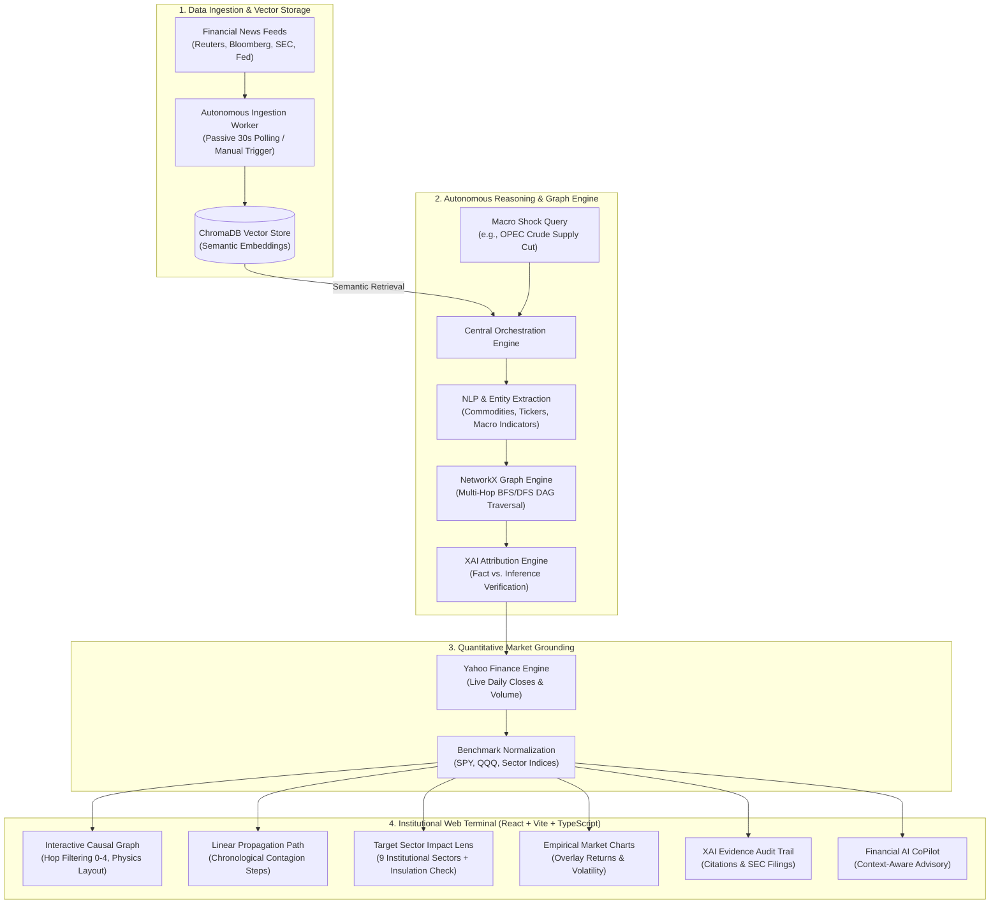

# FinGraph: From Macro Events to Market Contagion

> **Autonomous Financial Event & Market Impact Intelligence Terminal**  
> _Tagline: From Macro Events to Market Contagion_

[](https://fastapi.tiangolo.com/)
[](https://react.dev/)
[](https://www.trychroma.com/)
[](https://networkx.org/)
[](https://finance.yahoo.com/)
[]()

---

## 📌 Problem Statement Overview (PS 5 / AI • FINANCE • KNOWLEDGE GRAPHS)

> **Challenge Definition**:
> Financial events rarely affect a single company in isolation. A geopolitical conflict, commodity shock, central bank interest-rate pivot, or regulatory overhaul cascades across economic indicators, industry sectors, supply chains, and traded securities. Traditional financial terminals present market news as isolated stories, leaving analysts blind to hidden contagion pathways and structural spillover effects.
>
> **The Objective**:
> Engineer an autonomous AI system that converts unstructured financial intelligence into a **dynamic dependency knowledge graph**, mapping how primary macro shocks propagate into economic variables, affected sectors, and liquid traded instruments—fully backed by **verifiable evidence**, **empirical time-series validation**, and **clear uncertainty calibration**.

---

## 💡 What This Project Solves

| Problem in Modern Financial Intelligence                                                                                | How FinGraph Solves It                                                                                                                                                                                                                                                        |
| :---------------------------------------------------------------------------------------------------------------------- | :---------------------------------------------------------------------------------------------------------------------------------------------------------------------------------------------------------------------------------------------------------------------------- |
| **Fragmented News Feeds**: Analysts must manually read dozens of articles and connect disparate events in spreadsheets. | **Autonomous 6-Stage Extraction Pipeline**: Automatically digests raw textual news, extracts entities, maps causal relationships, and compiles a deterministic multi-hop Directed Acyclic Graph (DAG).                                                                        |
| **Black-Box AI Hallucinations**: LLMs fabricate market predictions and invent unsupported causal links.                 | **Explainable AI (XAI) Evidence Trail**: Every single edge in the knowledge graph is anchored to an immutable evidence citation with confidence scoring, distinguishing **observed facts** from **inferred transmissions**.                                                   |
| **Information Overload**: Broad macro graphs overwhelm sector-focused portfolio managers.                               | **Target Sector Analysis Lens**: Institutional analysts can isolate their specific sector (Energy, Tech, Transport, Financials, etc.). If an event does not affect a sector, the system displays a verified **Structural Insulation Assessment** rather than irrelevant data. |
| **Theoretical Claims Without Market Grounding**: Graph models often lack real-world empirical validation.               | **Live Quantitative Time-Series Fusion**: Seamlessly fetches real market data via Yahoo Finance to validate theoretical transmission vectors against empirical price behavior and volatility.                                                                                 |

---

## 🏗 System Architecture & End-to-End Workflow



---

## 🚀 Key Features & Innovations

### 1. 6-Stage Autonomous Transformation Pipeline

When an analyst inputs or selects an event query, the terminal executes a transparent 6-stage transformation pipeline with real-time UI telemetry:

1. **Vector DB Semantic Retrieval**: Searches ChromaDB for corroborating news articles and historical macro filings.
2. **Entity & Variable Extraction**: Extracts affected commodities, equity tickers, sovereign rates, and macro indicators.
3. **Sector Impact Classification**: Maps shock transmission vectors across 9 standardized institutional sectors (`XLE`, `XLK`, `IYT`, `XLF`, `XLU`, `XLY`, `XLB`, `XLRE`, `XLV`).
4. **Relationship Scoring & Evidence Attribution**: Calibrates transmission probabilities and anchors citations with confidence scores.
5. **Knowledge Graph Generation**: Compiles an interconnected Directed Acyclic Graph (DAG) with Hop 0 root trigger grounding.
6. **Propagation Path Tracing**: Computes linear multi-hop contagion trajectories leading to traded assets.

### 2. Interactive Multi-Hop Causal Graph

- **Hop Depth Control**: Filter network visibility from direct impact (**Hop 1**) through sector contagion (**Hop 2**) and downstream asset spillover (**Hop 3–4**).
- **Physics Canvas**: Smooth zoom, drag, and pan interactions with color-coded severity nodes (critical red, moderate amber, insulated green).
- **Node Inspector Sidebar**: Real-time financial intelligence panel detailing entity category, hop rank, upstream triggers, downstream targets, and direct navigation shortcuts.

### 3. Target Sector Analysis Lens (Billion-Dollar Analyst Tool)

Portfolio managers don't want to analyze the entire macro universe—they care about **their** specific portfolio.

- **Dedicated Sector Cards**: Displays node impact counts, active contagion status, and representative ETF tickers.
- **Instant Graph Scoping**: Clicking _"Analyze Sector"_ filters the causal graph, linear path, empirical time-series, and evidence trail strictly to that sector.
- **Structural Insulation Detection**: If an event has **zero** causal pathways affecting the selected sector, the platform avoids displaying broken or misleading graphs. Instead, it displays an institutional **Structural Insulation Assessment** (0.0% contagion risk, zero defensive hedging required, with quick buttons to switch to affected sectors).

### 4. Quantitative Empirical Time-Series Validation

- **Real Market Integration**: Pulls historical daily price closes and volumes directly from Yahoo Finance.
- **Benchmark Comparative Overlay**: Evaluates target ticker performance against the S&P 500 (`SPY`) and Nasdaq 100 (`QQQ`).
- **Event Shock Anchor Line**: Annotates the exact date of the macro event shock on the timeline.
- **Empirical Statistics**: Computes period return, benchmark excess alpha, 30-day annualized volatility, and maximum drawdown.

### 5. Explainable AI (XAI) Evidence Audit Trail

- **Strict Fact vs. Inference Separation**:
  - `FACT`: Direct empirical observation extracted from verified financial reports (e.g., OPEC production quota reduction numbers).
  - `INFERENCE`: Algorithmic causal deduction derived from macro transmission logic (e.g., elevated jet fuel costs depressing airline operating margins).
- **Attribution Confidence**: Every evidence card features an exact percentage confidence score and source badges (SEC Filings, Bloomberg, Reuters, Federal Reserve Releases).
- **One-Click Citation Copy**: Facilitates rapid compliance documentation and audit reporting.

### 6. Embedded Financial AI CoPilot

- Non-blocking slide-out assistant that maintains live context of the active graph, selected node, and user query.
- Strict anti-hallucination mandate: delivers concise institutional analysis (under 200 words) grounded entirely in the active causal graph.

---

## 📊 Illustrative Impact Chain (Example Walkthrough)

To understand how FinGraph processes an event, consider the benchmark event shock:

```
"Crude oil prices rise 12% after OPEC supply cut announcement"
```

```
[Hop 0: Primary Shock Trigger]
       │
       ▼ Crude Oil Spot Price (+12.4%)
[Hop 1: Direct Sector Contagion]
       ├─────────────────────────────────┬─────────────────────────────────┐
       ▼                                 ▼                                 ▼
Energy Exploration (XOM/CVX)      Transportation & Logistics        Refining Feedstock Costs
       │ (+5.8% Revenue Margin)          │ (-4.2% Fuel Surcharge)          │ (Valero / Marathon)
       ▼                                 ▼                                 ▼
[Hop 2: Macro Indicator Shift]    Jet Fuel Price Escalation         Chemical Polymers (DOW)
       │ (Headline Inflation +0.4%)      │                                 │
       ▼                                 ▼                                 ▼
[Hop 3: Capital Market Impact]    Airlines Operating Margin (DAL)   Consumer Packaged Goods
       │ (10-Year Treasury Yield +14bps) │ (-6.5% Net Income)              │ (Shipping surcharges)
       ▼                                 ▼                                 ▼
[Hop 4: Downstream Equities]      Commercial Air Freight (FDX)      Broad Market Index (SPY)
```

---

## 🛠 Tech Stack

### Backend

- **Framework**: Python 3.10+ / FastAPI (high-concurrency async endpoints)
- **Graph Reasoning**: NetworkX (Directed Acyclic Graph traversal, path scoring, cycle detection)
- **Vector Database**: ChromaDB (semantic embedding store for unstructured financial text)
- **Quantitative Engine**: `yfinance`, NumPy, Pandas (market price ingestion & volatility modeling)
- **Validation**: Pydantic v2 (strict type enforcement matching frontend API contracts)
- **Testing**: Pytest (comprehensive test suite across all modules)

### Frontend

- **Framework**: React 18 / TypeScript
- **Build Tool**: Vite (blazing fast bundling and HMR)
- **Styling**: Modern Institutional UI (Tailwind CSS utilities + Vanilla CSS variables)
- **Animation**: Framer Motion (page transitions, stage modals, smooth micro-interactions)
- **Icons**: Lucide React
- **Network Graph Rendering**: Custom SVG + Canvas accelerated physics layout

---

## 💻 Installation & Setup Guide

### Prerequisites

- **Python**: Version 3.10 or higher
- **Node.js**: Version 18.0 or higher
- **Package Managers**: `pip` (Python) and `npm` (Node.js)

---

### Step 1: Clone the Repository

```bash
git clone https://github.com/YourOrganization/FinGraph.git
cd final_hackwave_project
```

---

### Step 2: Backend Setup

1. Navigate to the `Backend` directory:
   ```bash
   cd Backend
   ```
2. Create and activate a Python virtual environment:

   ```bash
   # Windows
   python -m venv venv
   .\venv\Scripts\activate

   # Linux / macOS
   python3 -m venv venv
   source venv/bin/activate
   ```

3. Install required dependencies:
   ```bash
   pip install -r requirements.txt
   ```
4. Configure environment variables (optional):
   Create a `.env` file in the `Backend` directory or project root:
   ```env
   PORT=8000
   HOST=127.0.0.1
   ENVIRONMENT=production
   ```
5. Start the FastAPI backend server:
   ```bash
   python main.py
   ```
   _The backend will launch at `http://127.0.0.1:8000`._
   _API documentation is available at `http://127.0.0.1:8000/docs`._

---

### Step 3: Frontend Setup

1. Open a new terminal and navigate to the `Frontend` directory:
   ```bash
   cd Frontend
   ```
2. Install frontend dependencies:
   ```bash
   npm install
   ```
3. Launch the development server:

   ```bash
   npm run dev
   ```

   _The web application will launch at `http://localhost:5173`._

4. To verify production bundling:
   ```bash
   npm run build
   ```

---

### Step 4: Running Test Suites

To run the automated backend test suite (covering ingestion, VectorDB, graph reasoning, market data, and XAI engines):

```bash
python -m pytest Backend/modules -v
```

_(All 27 test cases pass out of the box)._

---

## 🧭 How to Use the Terminal (Step-by-Step)

```
┌──────────────┐     ┌──────────────┐     ┌──────────────┐     ┌──────────────┐
│  1. Ingest   │ ──> │   2. Graph   │ ──> │  3. Sectors  │ ──> │   4. Audit   │
│ Select Event │     │ Inspect Hops │     │ Filter Scope │     │ Verify Proof │
└──────────────┘     └──────────────┘     └──────────────┘     └──────────────┘
```

1. **Submit or Select an Event**:
   - On the **Home** view, pick a pre-loaded macro event (e.g., OPEC Supply Cut, Fed Rate Hike, Tech Antitrust Ruling) or type a custom financial headline.
   - Click **Run Impact Analysis** to trigger the 6-stage transformation pipeline modal.
2. **Explore the Impact Network**:
   - Once navigated to the **Graph** view, interact with the full macro propagation network.
   - Use the **Hop Filter** dropdown (`All`, `Hop 1`, `Hop 2`, `Hop 3`) to declutter the graph.
   - Click any node to open the **Financial Intelligence Sidebar** with detailed propagation metrics.
3. **Analyze Target Sectors**:
   - Scroll down to the **Target Sector Impact Lens** section below the graph.
   - Click **Analyze Sector** on any sector card (e.g., _Energy_, _Transportation_, _Healthcare_).
   - If the sector is affected, the graph, path, time-series, and evidence automatically scope to that sector.
   - If the sector is unaffected (e.g., _Healthcare_ during an _Oil Shock_), the system displays the **Structural Insulation Assessment** explaining why the sector is insulated.
4. **Trace the Propagation Path**:
   - Click **Propagation Path** in the sidebar or node inspector to view the step-by-step chronological contagion chain.
5. **Inspect Empirical Market Pricing**:
   - Open **Time-Series Analysis** to observe real market returns, volatility metrics, and benchmark comparisons for affected asset tickers.
6. **Verify the Evidence Trail**:
   - Navigate to **Evidence & Explainability** to inspect source filings, toggle between _Observed Facts_ and _Inferred Transmissions_, and verify confidence scores.

---

## 🌟 Uniqueness, Innovations & Institutional Value

1. **Zero Hallucination Tolerance**:
   Unlike generic LLM wrappers that fabricate financial connections, every transmission link in FinGraph requires an algorithmic path in NetworkX and an anchored evidence citation with verifiable confidence scores.
2. **Deterministic Uncertainty Communication**:
   FinGraph explicitly differentiates between empirical observations (`FACT`) and mathematical deductions (`INFERENCE`), communicating risk levels and transmission decay factors ($C_h = C_0 \cdot \gamma^h$) rather than false certainties.
3. **Structural Insulation Intelligence**:
   In finance, knowing what is **NOT** affected is just as lucrative as knowing what is. The Target Sector Lens identifies uncoupled sectors, allowing funds to execute zero-beta pair trades or avoid unnecessary hedging fees.
4. **Multi-Horizon Market Grounding**:
   Combines qualitative unstructured news ingestion with quantitative continuous-time market statistics, creating a unified bridge between fundamental and quantitative analysis.

---

## 📈 Scalability & Enterprise Roadmap

```
Phase 1 (Current)           Phase 2 (Near-Term)         Phase 3 (Enterprise)
─────────────────           ───────────────────         ────────────────────
• Single-node ChromaDB      • Distributed Milvus/Pinecone• Direct Bloomberg/Refinitiv Fix Feed
• yfinance market data      • Low-latency polygon.io API • Sub-millisecond HFT streaming
• Local NetworkX engine     • Neo4j Distributed Graph DB• Portfolio VaR & Stress-Testing Engine
• REST API endpoints        • WebSocket real-time feeds  • Automated SEC Form 13F/10-K parsers
```

- **Distributed Vector Search**: ChromaDB can be hot-swapped for Milvus or Pinecone for horizontal scaling across millions of institutional documents.
- **Enterprise Graph Database**: The NetworkX abstraction layer seamlessly migrates to Neo4j or Amazon Neptune for real-time graphs with billions of relationships.
- **Streaming Contagion Feeds**: WebSocket integration enables live ticks from Bloomberg and Refinitiv feeds for instantaneous shock alerts.

---

## 👥 Contributors & Acknowledgements

Developed for **Neura X**
- **System Architecture & Graph Engine**: FinGraph Core Engineering Team
- **Built With**: Python, FastAPI, React, TypeScript, ChromaDB, NetworkX, yfinance, Framer Motion.

---

## 📄 License

This project is licensed under the **MIT License** — feel free to use, modify, and distribute for academic, competitive, and institutional research purposes.
